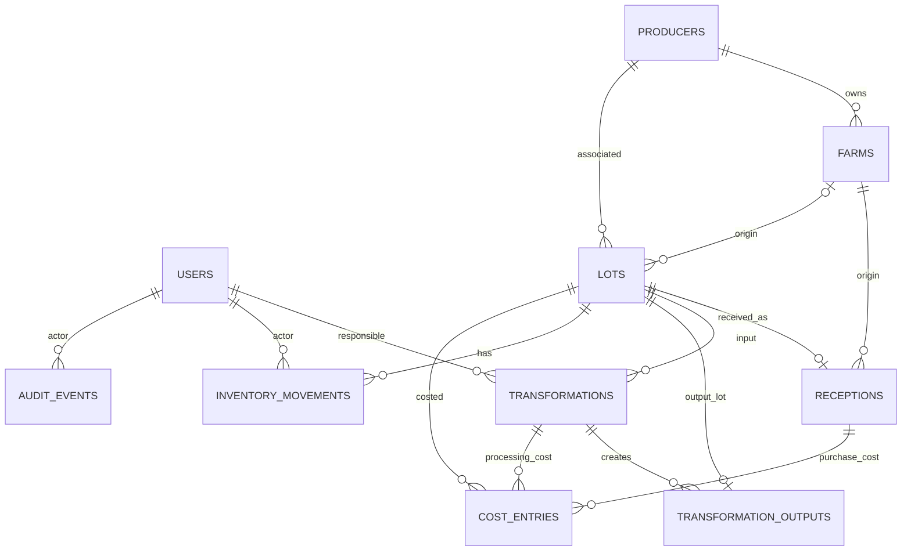

# E03 - Diseño del producto y de la solución

## Producto y alcance

`kallpa.cacao` es el nombre del repositorio. `AgroCacao Huila` aparece como nombre visual en la aplicación; el equipo debe confirmar la marca final. El producto busca conectar recepción, transformación, inventario y consulta del cacao de una asociación ficticia del Huila.

El flujo completo disponible es registrar productor/finca, recibir cacao, crear lote y movimiento, transformar, consultar linaje y presentar ficha pública. Una transformación consume un lote de entrada y crea una o varias salidas. No hay operaciones de venta implementadas.

## Arquitectura

FastAPI registra routers para autenticación, recepciones, transformaciones, lotes/trazabilidad, inventario, economía, alertas, ficha pública, exportaciones, usuarios y analítica. Compose despliega PostgreSQL, API FastAPI y frontend Nginx como servicios separados. El build pasó el 16-10-2026 y las rutas HTTP básicas respondieron 200; falta el recorrido visual completo en escritorio y móvil.

## Modelo de datos implementado

Entidades principales: `User`, `Producer`, `Farm`, `Lot`, `Reception`, `Transformation`, `TransformationOutput`, `InventoryMovement`, `CostEntry` y `AuditEvent`. Ya no existe `FinanceRecord`: el precio propuesto vive en `Transformation` y todos los costos se registran únicamente en `CostEntry`.

### Decisiones de consistencia y limitaciones del esquema

- Recepción registra la operación y se enlaza uno a uno con un lote. La cantidad y finca de origen también están en el lote; esos datos repetidos entre `Reception` y `Lot` aún requieren mantenerse consistentes.
- El saldo rápido está en `Lot.available_quantity`; el libro `InventoryMovement` conserva recepción, consumo y producción. El informe de operación debe incluir una conciliación de ambos.
- El consumo verifica disponibilidad y bloquea la fila del lote con `SELECT ... FOR UPDATE` en la ruta de transformación. La creación de transformación, el consumo, las salidas, los movimientos, los costos y la auditoría se ejecutan en una transacción.
- La idempotencia de transformación guarda una clave única y una huella del payload. Repetir clave y contenido devuelve el resultado anterior; reutilizar la clave con contenido distinto responde conflicto.
- `CostEntry` es la fuente única de costos. `purchase` queda asociado al lote recibido; `processing` se vincula a la transformación y se distribuye entre las salidas según masa. La economía suma los costos de etapa vinculados a la transformación y excluye la compra de materia prima. La migración `e4219b1a7c30` conserva el valor que exponía la economía previa y elimina las columnas/tablas duplicadas.
- `Lot` es la fuente autoritativa del código, cantidad y estado del producto procesado. `TransformationOutput` conserva solo la relación entre la operación y el lote; sus cantidades se leen de `Lot.received_quantity`. La migración elimina esos campos duplicados de `Transformation` y del vínculo.
- `AuditEvent` almacena actor, tipo e identificador de entidad, accion, valores anterior/nuevo y fecha. La razon de estado queda en `after_value`; un listener ORM y triggers de base de datos impiden modificar o borrar eventos.

## Reglas de negocio

- Recepción registra la operación y se enlaza uno a uno con un lote. La cantidad y finca de origen también están en el lote; esos datos repetidos entre `Reception` y `Lot` aún requieren mantenerse consistentes.
- Transformación: acepta un lote de entrada; verifica que exista, no esté bloqueado, tenga stock suficiente y use unidades compatibles. El exceso de salida requiere registrar una incidencia.
- Merma: `(cantidad de entrada - cantidad de salida) / cantidad de entrada × 100`. La alerta de este caso se activa si el resultado es estrictamente superior a 15 %; 15 % exacto no la activa.
- Registro incompleto: una etapa genera alerta si no tiene responsable o no tiene ningun registro `processing` de costos. Un costo registrado de COP 0 cuenta como dato presente; la ausencia del registro es lo que se marca.
- Retraso: un lote genera alerta si tiene existencia disponible mayor que cero, no esta bloqueado y han pasado mas de `DELAY_ALERT_DAYS` dias desde su ultima etapa. Si no tiene etapas, se toma la recepcion; los lotes sinteticos heredados sin fila `Reception` usan `Lot.received_on` como respaldo. El valor por defecto es 7 dias y es configurable.
- Economía: costo unitario = costos de etapa vinculados a la transformación / cantidad de salida vendible; margen = `(precio - costo unitario) / precio × 100`. Con salida o precio igual a cero, el indicador correspondiente no se calcula. La API explica que excluye la compra de materia prima.
- Estado: `pending`, `released` o `blocked`. El administrador cambia estados con motivo. Solo `released` se informa disponible en la ficha pública.
- Ficha pública: usa un esquema de salida permitido; no serializa contacto del productor ni costos internos.

## Acceso por rol

| Rol | Capacidades descritas por la API | Límite |
|---|---|---|
| Operador | Autenticarse, consultar fincas/lotes, registrar recepciones y transformaciones. | No debe cambiar estados ni consultar informes reservados al administrador. |
| Administrador | Operaciones del operador, cambios de estado, economía, alertas, auditoría y CSV. | Las rutas aplican autorización en backend. |
| Comprador público | Consultar ficha por código sin autenticación. | Recibe únicamente datos aprobados; un producto bloqueado no aparece disponible. |

La API incluye administración de usuarios y `GET /api/v1/analytics/dashboard` para indicadores administrativos. No se implementa el ciclo de ventas. El frontend incluye vistas para inventario, filtros/CSV, economía, auditoría y usuarios.

## Diferenciador offline y límites

El alcance que se ha ensayado es captura de recepciones sin conexión y sincronización idempotente al recuperar red. La cola local pertenece al navegador y no reemplaza PostgreSQL. Una recepción pendiente necesita volver a sincronizarse; la base del servidor es la fuente persistente. No afirmar transformación offline, sincronización en segundo plano ni recuperación en otro dispositivo sin una prueba reproducible de esas funciones.

## Decisiones técnicas

| Decisión | Razón | Alternativa considerada | Limitación actual |
|---|---|---|---|
| FastAPI con routers y servicios en un monolito modular | Permite documentar endpoints OpenAPI y mantener reglas del lado servidor en un MVP pequeño. | Servicios independientes. | No se ha separado el despliegue por dominio. |
| PostgreSQL para operación con Docker; SQLite para pruebas y desarrollo local | PostgreSQL conserva los datos en un volumen y soporta bloqueos de fila para consumos concurrentes. | Una base embebida únicamente. | Las pruebas SQLite no prueban concurrencia PostgreSQL; esa prueba debe ejecutarse aparte contra una instancia desechable. |
| Lotes explícitos como salida de transformación | Permite consultar inventario y linaje en ambos sentidos. | Guardar las cantidades de salida solo como campos de la transformación. | Se conserva el formato histórico de entrada de la API; la relación persistida entre transformación y lotes de salida es autoritativa. |

## Diferencias entre diseño y estado entregable

La PWA canónica está en `src/frontend/`; la API ejecutada está en `backend/`. El build de producción pasó el 16-10-2026 y la web/API respondieron HTTP 200 en una comprobación básica. Aún falta el recorrido manual de tareas en escritorio y móvil, la prueba offline de entrega y la verificación de restauración.
