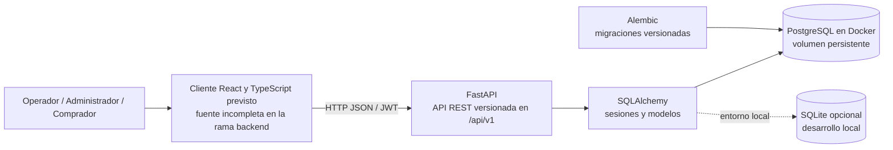
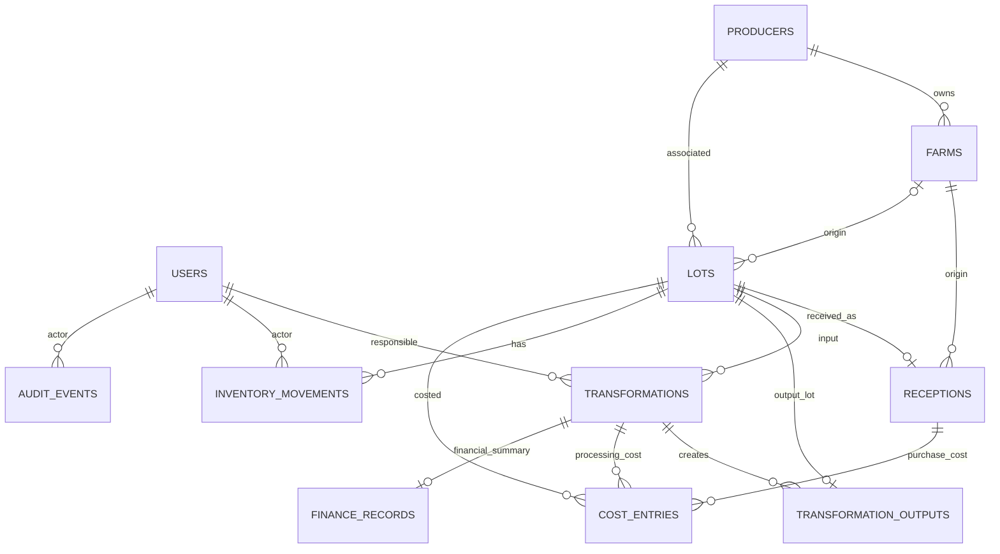

# E03 - Diseño del producto y de la solución

## Producto y alcance

`kallpa.cacao` es el nombre del repositorio. `AgroCacao Huila` aparece como nombre visual en la aplicación; el equipo debe confirmar la marca final. El producto busca conectar recepción, transformación, inventario y consulta del cacao de una asociación ficticia del Huila.

El flujo backend disponible es: registrar productor/finca, recibir cacao, crear un lote y su movimiento de inventario, transformar el lote, consultar el linaje y presentar una ficha pública del lote procesado. El alcance de una transformación es un lote de entrada y una o varias salidas. No hay operaciones de venta implementadas. La rama actual se llama `backend`; el frontend no está completo en esta copia, por lo que los recorridos visuales no se consideran verificados aquí.

## Arquitectura

FastAPI registra routers para autenticación, recepciones, transformaciones, lotes/trazabilidad, inventario, economía, alertas, ficha pública y exportaciones. Las reglas de negocio están en servicios Python. SQLAlchemy maneja el acceso a datos; Alembic versiona el esquema. Docker Compose define PostgreSQL, API y frontend; sin el código frontend completo, no se debe presentar el arranque de los tres servicios desde esta rama como una instalación verificada.

## Modelo de datos implementado

Entidades principales: `User`, `Producer`, `Farm`, `Lot`, `Reception`, `Transformation`, `TransformationOutput`, `InventoryMovement`, `CostEntry`, `FinanceRecord` y `AuditEvent`. Una transformación apunta a un lote de entrada; `TransformationOutput` enlaza esa transformación con cada lote de salida. El linaje de la salida se conserva en el propio lote y en esa tabla intermedia.

### Decisiones de consistencia y limitaciones del esquema

- Recepción registra la operación y se enlaza uno a uno con un lote. La cantidad y finca de origen también están en el lote; hay datos repetidos entre `Reception` y `Lot` que requieren mantener consistentes. `FinanceRecord.transformation_id` también es único, por lo que el resumen financiero es de cero o uno por transformación.
- El saldo rápido está en `Lot.available_quantity`; el libro `InventoryMovement` conserva recepción, consumo y producción. El informe de operación debe incluir una conciliación de ambos.
- El consumo verifica disponibilidad y bloquea la fila del lote con `SELECT ... FOR UPDATE` en la ruta de transformación. La creación de transformación, el consumo, las salidas, los movimientos, los costos y la auditoría se ejecutan en una transacción.
- La idempotencia de transformación guarda una clave única y una huella del payload. Repetir clave y contenido devuelve el resultado anterior; reutilizar la clave con contenido distinto responde conflicto.
- El esquema actual conserva importes en más de un lugar (`Transformation.costs_cop`, `FinanceRecord` y `CostEntry`) y también conserva estado/código de salida en la transformación además del lote de salida. Por tanto, la fuente única de costos y estados no está demostrada en este esquema; cualquier cálculo debe documentar de qué registro lee.
- `AuditEvent` almacena actor, tipo e identificador de entidad, acción, valores anterior/nuevo y fecha. El motivo de un cambio de estado queda en el valor posterior y en el lote; no hay una columna `reason` dedicada ni un trigger de base de datos que impida `UPDATE`/`DELETE` de auditoría. La inmutabilidad estricta sigue pendiente.

## Reglas de negocio

- Recepción: la cantidad debe ser positiva; la unidad del MVP es kg. La clave de idempotencia evita duplicados ante reintentos.
- Transformación: acepta un lote de entrada; verifica que exista, no esté bloqueado, tenga stock suficiente y use unidades compatibles. El exceso de salida requiere registrar una incidencia.
- Merma: `(cantidad de entrada - cantidad de salida) / cantidad de entrada × 100`. La alerta de este caso se activa si el resultado es estrictamente superior a 15 %; 15 % exacto no la activa.
- Economía descrita por el servicio actual: costo unitario = costo total informado / salida vendible; margen = `(precio - costo unitario) / precio × 100`. Con salida o precio igual a cero, el indicador correspondiente no se calcula. El costo se presenta como agregado informado; no hay desglose fiable por categoría documentado.
- Estado: `pending`, `released` o `blocked`. El administrador cambia estados con motivo. Solo `released` se informa disponible en la ficha pública.
- Ficha pública: usa un esquema de salida permitido; no serializa contacto del productor ni costos internos.

## Acceso por rol

| Rol | Capacidades descritas por la API | Límite |
|---|---|---|
| Operador | Autenticarse, consultar fincas/lotes, registrar recepciones y transformaciones. | No debe cambiar estados ni consultar informes reservados al administrador. |
| Administrador | Operaciones del operador, cambios de estado, economía, alertas, auditoría y CSV. | Las rutas aplican autorización en backend. |
| Comprador público | Consultar ficha por código sin autenticación. | Recibe únicamente datos aprobados; un producto bloqueado no aparece disponible. |

La administración de usuarios, ventas y analítica agregada no se presenta como capacidad disponible en la API de esta rama. Las pantallas que las sugieran deben quedar marcadas como no conectadas o fuera del alcance actual.

## Diferenciador offline y límites

El alcance que se ha ensayado es captura de recepciones sin conexión y sincronización idempotente al recuperar red. La cola local pertenece al navegador y no reemplaza PostgreSQL. Una recepción pendiente necesita volver a sincronizarse; la base del servidor es la fuente persistente. No afirmar transformación offline, sincronización en segundo plano ni recuperación en otro dispositivo sin una prueba reproducible de esas funciones.

## Decisiones técnicas

| Decisión | Razón | Alternativa considerada | Limitación actual |
|---|---|---|---|
| FastAPI con routers y servicios en un monolito modular | Permite documentar endpoints OpenAPI y mantener reglas del lado servidor en un MVP pequeño. | Servicios independientes. | No se ha separado el despliegue por dominio. |
| PostgreSQL para operación con Docker; SQLite para pruebas y desarrollo local | PostgreSQL conserva los datos en un volumen y soporta bloqueos de fila para consumos concurrentes. | Una base embebida únicamente. | Las pruebas SQLite no prueban concurrencia PostgreSQL; esa prueba debe ejecutarse aparte contra una instancia desechable. |
| Lotes explícitos como salida de transformación | Permite consultar inventario y linaje en ambos sentidos. | Guardar las cantidades de salida solo como campos de la transformación. | Persisten campos de salida duplicados en `Transformation` y `Lot`. |

## Diferencias entre diseño y estado entregable

Esta rama contiene backend y pruebas automatizadas. La fuente frontend aparece incompleta/vacía en esta copia, aunque Docker Compose intenta construirla; por ello, las pantallas, responsive, PWA, QR decorativo y sincronización de IndexedDB no se certifican con este repositorio. El informe en `concurso/Revision_funcional_y_plan_siguiente.txt` registra pruebas anteriores y sus límites; no reemplaza una nueva ejecución sobre el commit final.
